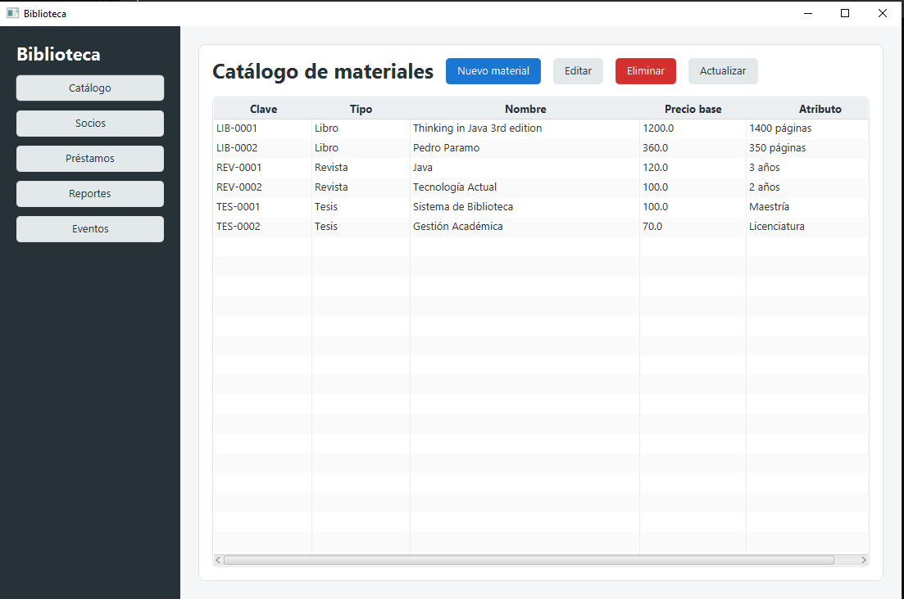
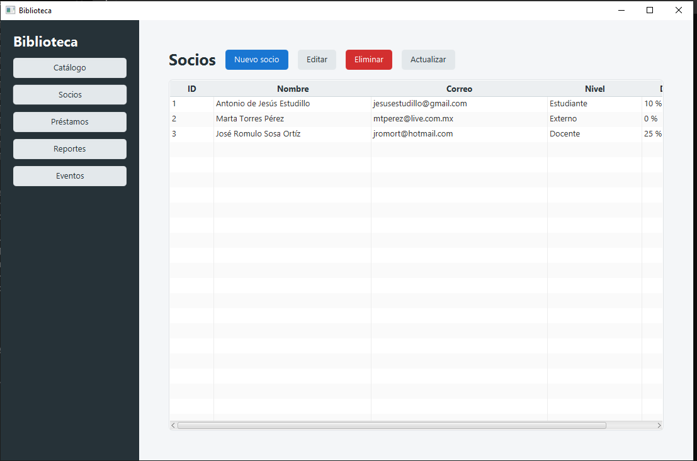
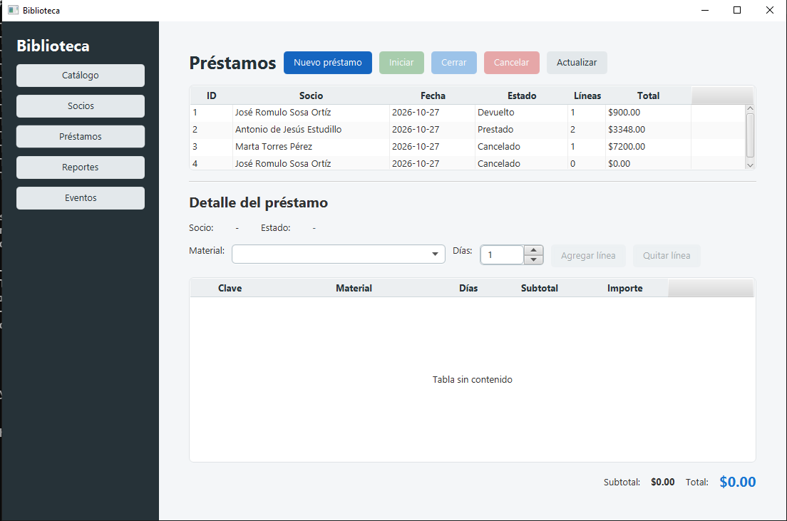
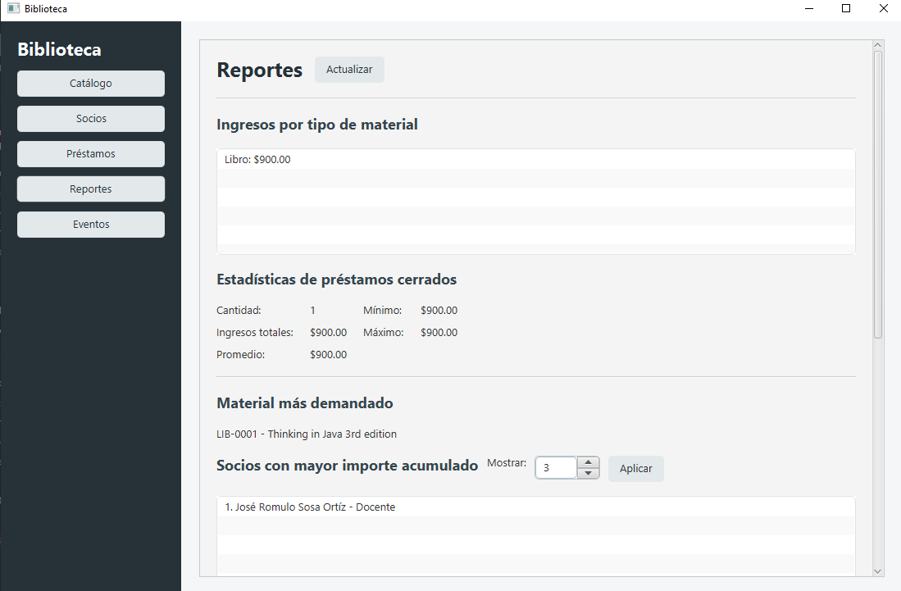
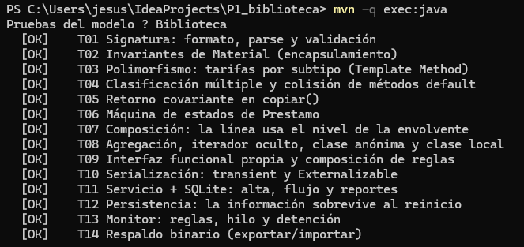

# Miniproyecto 1: Sistema de Préstamos de una Biblioteca Universitaria

Variante: **esqueleto**. Paquete raíz `mx.tecnm.orizaba.tp.biblioteca`. Java 21 + SQLite.

```
mvn -q compile && mvn -q exec:java        # PruebasModelo
mvn -q exec:java -Pdemo                    # DemoModelo
```

Consulta el documento DOCX del proyecto para la especificación completa.

# Sistema de Préstamos de una Biblioteca Universitaria

Proyecto desarrollado para la materia **Tecnologías de Programación** de la Maestría en Sistemas Computacionales.

El sistema permite administrar los materiales, socios y préstamos de una biblioteca universitaria mediante una aplicación de escritorio desarrollada con JavaFX. El proyecto integra programación orientada a objetos, programación funcional, concurrencia, persistencia con SQLite, serialización, eventos y patrones de diseño orientados a mantener una arquitectura modular.

---

## Tecnologías utilizadas

- Java 21 LTS
- JavaFX 21.0.9
- FXML
- CSS
- Maven
- SQLite
- SQLite JDBC 3.46.1.3
- PlantUML
- Javadoc

---

## Funcionalidades principales

### Catálogo de materiales

El sistema permite registrar, consultar, editar y eliminar materiales.

Los tipos disponibles son:

- Libro
- Revista
- Tesis

Cada tipo posee un atributo específico:

- Libro: número de páginas.
- Revista: antigüedad en años.
- Tesis: grado académico.

Cada material recibe automáticamente una `Signatura` compuesta por un prefijo y un número consecutivo.

Ejemplos:

```text
LIB-0001
REV-0001
TES-0001
```

---

## Gestión de socios

La aplicación permite registrar, consultar, editar y eliminar socios.

Cada socio posee:

- Identificador.
- Nombre.
- Correo electrónico único.
- Nivel.

Los niveles disponibles son:

- Externo: 0 % de descuento.
- Estudiante: 10 % de descuento.
- Docente: 25 % de descuento.

El nivel se utiliza durante el cálculo del total de los préstamos.

---

## Gestión de préstamos

Los préstamos permiten asociar uno o más materiales a un socio.

Desde la interfaz es posible:

- Abrir un préstamo.
- Seleccionar el socio.
- Agregar materiales.
- Especificar los días de préstamo.
- Quitar líneas mientras el préstamo se encuentra abierto.
- Consultar subtotal y total.
- Cambiar el estado del préstamo.
- Cancelar préstamos.

Los estados manejados son:

```text
Registrado → Prestado → Devuelto
     │          │
     └──────────┴────→ Cancelado
```

Internamente corresponden a:

```text
ABIERTA
EN_CURSO
CERRADA
CANCELADA
```

Las reglas de transición se encuentran en el modelo y no en la interfaz gráfica.

---

## Cálculo de tarifas

Cada subtipo de `Material` implementa su propio cálculo de tarifa.

### Libro

La tarifa se calcula de forma lineal utilizando el precio base y los días del préstamo.

### Revista

Las revistas con más de cinco años reciben una reducción en su tarifa.

### Tesis

Los primeros tres días no generan costo. A partir del cuarto día se aplica la tarifa correspondiente.

El cálculo se realiza mediante polimorfismo a través de la jerarquía de `Material`.

---

## Reportes

La aplicación incluye una sección de reportes generados mediante Streams.

Entre los reportes disponibles se encuentran:

- Ingresos agrupados por tipo de material.
- Material más demandado.
- Socios con mayor importe acumulado.
- Estadísticas de préstamos cerrados.
- Conteo de préstamos por estado.
- Partición de materiales por precio.

Los cálculos se realizan en la fachada `Biblioteca`; la interfaz únicamente presenta los resultados.

---

## Eventos y monitor

El sistema posee un monitor periódico encargado de revisar reglas de negocio.

Entre las acciones del monitor se encuentran:

- Cancelar automáticamente préstamos abiertos sin materiales cuando cumplen la antigüedad establecida.
- Generar una alerta cuando un préstamo en curso supera el plazo permitido.

Los eventos pueden ser de los siguientes tipos:

```text
ALTA
CAMBIO_ESTADO
ALERTA
CANCELACION_AUTOMATICA
```

La interfaz recibe estos eventos mediante `OyenteEvento`.

Debido a que el monitor funciona en un hilo diferente al hilo gráfico de JavaFX, los cambios visuales se realizan utilizando:

```java
Platform.runLater(...)
```

Esto permite actualizar la interfaz sin violar las reglas de concurrencia de JavaFX.

---

## Arquitectura

El proyecto se encuentra dividido en paquetes con responsabilidades específicas.

```text
mx.tecnm.orizaba.tp.biblioteca
│
├── app
├── concurrencia
├── eventos
├── funcional
├── modelo
├── persistencia
├── servicio
└── ui
```

### `modelo`

Contiene las abstracciones principales del dominio:

- `Material`
- `Material.Libro`
- `Material.Revista`
- `Material.Tesis`
- `Signatura`
- `Socio`
- `Prestamo`
- `Prestamo.Linea`
- `Acervo`
- `Nivel`
- `Estado`

### `funcional`

Contiene las interfaces utilizadas para programación funcional:

- `Regla<T>`
- `FabricaElemento<E,A>`
- Reglas reutilizables.

### `eventos`

Contiene el sistema de publicación de eventos:

- `Evento`
- `TipoEvento`
- `OyenteEvento`

### `concurrencia`

Contiene la lógica reutilizable para tareas periódicas:

- `TareaPeriodica`

### `persistencia`

Contiene las clases relacionadas con SQLite y serialización:

- `ConexionSQLite`
- `Repositorio`
- `RepositorioMaterialSQLite`
- `RepositorioSocioSQLite`
- `RepositorioPrestamoSQLite`
- `Respaldo`

### `servicio`

Contiene la fachada:

```text
Biblioteca
```

La fachada centraliza los casos de uso y sirve como punto de acceso al modelo desde la interfaz.

### `ui`

Contiene las vistas FXML y los controladores JavaFX:

- `PrincipalController`
- `CatalogoController`
- `MaterialFormController`
- `SociosController`
- `SocioFormController`
- `PrestamosController`
- `ReportesController`
- `EventosController`

### `app`

Contiene el punto de composición y ejecución de la aplicación.

`BibliotecaApp` crea la conexión SQLite y la instancia compartida de `Biblioteca`, que posteriormente es inyectada en los controladores.

De esta forma, los controladores de la interfaz no acceden directamente a los repositorios ni ejecutan SQL.

---

## Persistencia

La información es almacenada utilizando SQLite.

El archivo principal es:

```text
datos.db
```

Se utilizan repositorios separados para:

```text
Material
Socio
Prestamo
```

Las operaciones principales son:

- Inserción.
- Actualización.
- Consulta.
- Eliminación.
- Transacciones.
- Reconstrucción de objetos.
- Operaciones por lotes.

Los préstamos y sus líneas se almacenan de forma transaccional para mantener la consistencia de los datos.

---

## Base de datos de ejemplo

El proyecto incluye un archivo `datos.db` preparado para demostrar el funcionamiento del sistema.

Contiene al menos:

```text
6 materiales
3 socios
4 préstamos
```

Los cuatro préstamos se encuentran en estados diferentes:

```text
Registrado
Prestado
Devuelto
Cancelado
```

La persistencia fue comprobada cerrando completamente la aplicación y ejecutándola nuevamente.

---

## Interfaz gráfica

Se utilizó **JavaFX 21 con FXML y CSS**.

### Razones de elección

JavaFX permitió:

- Mantener la interfaz completamente en Java.
- Separar la estructura visual mediante FXML.
- Utilizar componentes como `TableView`, `ComboBox`, `Spinner` y `ListView`.
- Aplicar una hoja de estilos CSS común.
- Gestionar correctamente eventos procedentes de otros hilos mediante `Platform.runLater()`.

### Separación de responsabilidades

Los archivos FXML contienen la estructura visual.

Los controladores coordinan las acciones del usuario.

La lógica de negocio permanece dentro del modelo y la fachada `Biblioteca`.

La interfaz no ejecuta SQL.

---

## Capturas de la Interfaz

### Catálogo


### Socios 


### Préstamos


### Reportes


---

## Compilación

Desde la carpeta raíz del proyecto ejecutar:

```bash
mvn clean compile
```

---

## Ejecución de las pruebas

Para ejecutar las pruebas del modelo:

```bash
mvn -q exec:java
```

El resultado esperado es:

```text
Resultado: 14 aprobadas, 0 fallidas
```


---

## Ejecutar la aplicación gráfica

Para iniciar la interfaz JavaFX:

```bash
mvn javafx:run
```

La aplicación utilizará automáticamente el archivo:

```text
datos.db
```

---

## Generar Javadoc

La documentación puede generarse con:

```bash
mvn javadoc:javadoc
```

La documentación HTML generada puede encontrarse dentro de:

```text
target/reports/apidocs/
```

La página principal es:

```text
index.html
```

---

## Diagrama de clases

El proyecto incluye un diagrama de clases actualizado realizado con PlantUML.

Se recomienda conservar:

```text
diagramas/
├── modelo_actualizado.puml
├── modelo_actualizado.png
└── modelo_actualizado.svg
```

El diagrama contiene las principales relaciones entre:

- Modelo.
- Persistencia.
- Servicio.
- Eventos.
- Concurrencia.
- Interfaz JavaFX.
- Aplicación.

---

## Pruebas realizadas

Además de las pruebas automáticas proporcionadas, se realizaron comprobaciones manuales sobre la interfaz.

Entre ellas:

- Registro de materiales.
- Modificación de materiales.
- Eliminación de materiales.
- Registro y modificación de socios.
- Validación de correos.
- Apertura de préstamos.
- Adición y eliminación de líneas.
- Cambio de estados.
- Cálculo de subtotales y totales.
- Aplicación de descuentos.
- Persistencia después de reiniciar.
- Generación de reportes.
- Recepción de eventos.
- Funcionamiento del monitor.

---

## Javadoc

El código propio incluye documentación Javadoc en las clases y métodos públicos relevantes.

Se documentaron, entre otros:

- Parámetros mediante `@param`.
- Valores de retorno mediante `@return`.
- Excepciones mediante `@throws`.
- Parámetros genéricos mediante `@param <T>`.

---

## Uso de inteligencia artificial

El uso de herramientas de inteligencia artificial durante el proyecto está documentado en:

```text
BITACORA_IA.md
```

La IA fue utilizada principalmente como herramienta de apoyo para:

- Explicación conceptual.
- Revisión de implementaciones.
- Depuración de errores.
- Comprensión de persistencia SQLite.
- Revisión de Javadoc.
- Generación de código repetitivo de interfaz gráfica.

Las implementaciones incorporadas fueron revisadas, compiladas y comprobadas durante el desarrollo.

---

## Estructura recomendada para la entrega

```text
P1_biblioteca/
│
├── src/
├── diagramas/
│   ├── modelo_actualizado.puml
│   ├── modelo_actualizado.png
│   └── modelo_actualizado.svg
│
├── datos.db
├── BITACORA_IA.md
├── README.md
├── pom.xml
├── compilar.sh
└── probar.sh
```

---

## Estado del proyecto

```text
Modelo                      Completado
Pruebas automáticas         14/14
Persistencia SQLite         Completada
Interfaz JavaFX             Completada
CRUD de materiales          Completado
CRUD de socios              Completado
Gestión de préstamos        Completada
Reportes                    Completados
Eventos y monitor           Completados
Base de datos de ejemplo    Completada
Javadoc                     Completado
Diagrama de clases          Actualizado
Bitácora de IA              Completada
```

---

## Autor

Proyecto académico individual desarrollado para la materia **Tecnologías de Programación** de la Maestría en Sistemas Computacionales.